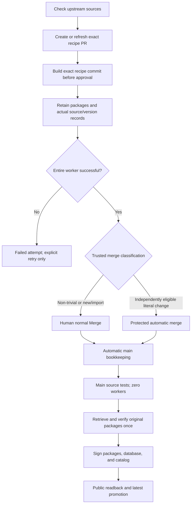

# Implementation plan

**Status: publication, signed promotion to `latest`, and hosted installation proof are complete. The remaining operational and external-recipe boundaries are still open; this is not full plan completion.**

The user selected a small prerequisite followed by **one atomic core cutover PR**, with reviewable component commits inside that PR. The earlier instruction to deploy small component PRs is superseded by this sequencing. Do not activate an incomplete combination of old and new worker contracts.

Documentation is authored slowly from the supplied source and observed evidence. This is the existing plan, not a new changelog. Implementation and read-only smoke do not complete the live acceptance list.

## 1. Target flow

### Core rules

- Build before human approval. Human normal Merge is approval for non-trivial changes.
- New recipes, first import conversion, and executable/non-trivial recipe changes require human merge. Independently eligible literal version, `pkgrel`, checksum, and source updates may auto-merge after trusted validation.
- Only trusted manager code determines automatic eligibility. Caller flags cannot override classification.
- Reuse packages only from fully successful worker attempts with retained durable output. Merge and repository inclusion never rebuild them.
- A worker that fails anywhere is a failed attempt. An explicit retry may compile again under a fresh request.
- No failed-job salvage, historical worker searches, compilation-success checkpoints, or transport-recovery workers/arguments/formats.
- No OMP-specific checks in shared infrastructure or consumer proofs. Recipe-owned `check()` tests remain.
- Check package-byte integrity at repository inclusion, not immediately after creation or for merge. Generic native output identity/version/architecture/declaration checks remain.
- Preserve container, credential, signature, provenance, signed-history, source/license, and rollback guarantees.

## 2. Data and workflow arguments

Reuse the established layout:

| Location | Purpose |
| --- | --- |
| `upstream/<package>.json` | Repositories, branches, tags, and version-related source tracking |
| `inputs/<package>.json` | Actual source revisions and version from the accepted build |
| Direct pending/request/result records | Exact PR/head, observed targets, request, registered worker, outcome, actual metadata, and durable output reference |
| `acceptance/` | Accepted recipe-to-original-successful-build mapping |

Record full actual commits for each declared Git source and reachable tag/version context where `pkgver` needs it. Git source IDs support 40 or 64 hexadecimal characters; GitHub recipe/controller identities remain 40-character SHAs.

Do not change source checkout, history, tags, or recipe source declarations merely for tracking. Let normal native `makepkg` determine the resulting version. Store actual generated metadata, version, and source records outside package archives. Keep the original recipe tree and `.SRCINFO` declaration; do not refresh metadata into post-build commits or loops.

Only a genuine `pkgver()` recipe may differ in `pkgver`. Do not ignore epoch, `pkgrel`, names, architecture, sources, or dependencies. The actual version must be greater than the accepted predecessor. Manual/edited heads use `declared_metadata`; automatic discovery and unedited automation proposals retain derivation checks.

Accepted records advance only after accepted recipe merge. Discovery, pending requests, successes awaiting merge, and failures do not change main's accepted baseline.

Worker inputs are exactly package name, PR number, recipe SHA, and reserved request ID. Trusted merge policy remains coordinator/finalizer data. There is no extra `manifest_reference` system. The compiler receives neither merge authority nor signing credentials.

The worker registers exact run/attempt and exports the exact recipe itself. A queued immutable request may execute under a later authenticated trusted-main harness; retain original request identity and record actual producer/harness without compatibility scans or request rewriting.

## 3. Delivery sequencing

### Prerequisite: narrow source routing only

The small prerequisite routes unchanged-package main PR events to the existing source-only verification flow. Its metadata job checks out the protected event base, never candidate code. Drafts and captured bases behind main skip dispatch. Source validation ends with evidence/statuses and waits for human normal Merge; it has no source-merge job/helper or finalizing CLI mode.

The exact immutable `source-review-<H>` bootstrap tag and protection remain for installing this stage. Old recipe approval, worker, cache, checkpoint, and recovery behavior is unchanged until the core cutover. Do not remove old settings during the prerequisite.

### Atomic core PR

Core PR #67 merged on protected main after prerequisite PR #66. Component commits are review units, not separately deployed partial routes. Live acceptance remains incomplete.

Before activation, inventory old active runs and directly known fully successful outputs. Settle or stop old managers/workers. Migrate directly known successful records where valid or reuse existing signed snapshots. Never admit failed-worker output through a legacy exception.

Install coherent protected code first. Only then apply the inspected environment-ruleset removal plan, verify a no-change plan, and retire the temporary immutable-tag installation path. Keep historical authority needed to verify original producer proof; do not invent new old-style approval authority.

### A. Simplify records and manager reads

**Files:** `recipe_state.py`, `update.py`, `recipe_candidates.py`, `package_runs.py`, source helpers, `update.yml`, `candidate-dispatch.yml`.

Implemented scope:

- One operation-level `StateSnapshot`, resolving state tip once and caching immutable values.
- Batch direct-key reads and paginated GraphQL open-PR heads/check states.
- Local comparison and only necessary writes.
- Directly known PR tracking after merge or closure.
- Read-only output lookup; missing records fail explicitly, never launch a historical search.
- Direct pending package pointer plus immutable request/result records, with exact leases/CAS.

| Situation | Action |
| --- | --- |
| Same inputs queued, running, or successfully built | No new dispatch |
| Same inputs failed | Report terminal failure; no periodic retry |
| Upstream advances while worker runs | Wait for its actual result |
| Newer sources remain afterward | Refresh the same automation-owned PR |
| Human edits recipe | Preserve edits and use declared metadata; do not overwrite |
| Captured source base behind main | Skip it, continue other work, do not rebase the human branch |

Maintain one update PR per package. Build-affecting head changes invalidate prior checks. Unchanged receipts with no open PR leave retained branches untouched. Writes/dispatches require authenticated watcher ownership.

### B. Prevent duplicate dispatches and poll exact workers

**Files:** state reservation/registration and `package_runs.py`.

GitHub dispatch does not return the producer run ID. Reserve a unique bounded request identity under the state writer before dispatch. The worker registers its actual run/attempt before compilation. Poll only that exact producer afterward.

Do not list the latest workers or scan history. Missing/ambiguous registration must not cause repeated dispatch. An explicit failed/unregistered retry reserves a fresh request under identity/CAS checks. Stale workers cannot overwrite a newer active request. Worker concurrency alone does not deduplicate queued builds.

### C. Simplify the worker and build gate

**Files:** `build-package.yml`, `candidate.yml`, `native.py`, `recipe_gate.py`, `build_store.py`, `package_runs.py`, `build.sh`.

Keep one independent hosted x86_64 worker per package. It must:

1. Validate the immutable request and trusted actual workflow identity, register the producer, and export the exact recipe.
2. Build in the disposable unprivileged container without credentials.
3. Run recipe-defined tests.
4. Check names, output set, architecture, version, and non-version source/dependency declarations.
5. Record actual full Git revisions, reachable tag context, generated metadata, and dynamic version.
6. Retain original package output, request/context, attestation, and direct result in durable storage.
7. Finish the entire worker attempt successfully.

The manager confirms whole-job final success, not a successful internal step or available files. Persistence happens before conclusion and is not success authority by itself.

Implemented simplifications:

- One candidate job with preparation, conditional collection, finalization, and guarded failure reporting; no separate candidate validate job or pre-build review jobs.
- No merge-time package downloads or package hashing, and no native package SHA fields.
- Dynamic `pkgver` accepted without comparing it to a stale declaration as an equality requirement.
- No post-build metadata refresh/rebuild loops.
- Own-head isolated cache progress, including failed compilation progress.
- Accepted cache seeding from the complete actual receipt `input_digest` plus exact producer run/attempt key and original saved path. Exact match admission only; miss is cold build.

### D. Merge and update main automatically

**Files:** `recipe_acceptance.py`, candidate finalization, `update.py`, `verification.yml`, `source_review.py`.

Keep required contexts `verify`, `recipe-policy`, and `candidate-build`. `recipe-policy` means supported input and trusted merge classification, not pre-build human approval.

- Successful non-trivial/new/import/executable recipe PRs stay open until human normal Merge.
- Independently eligible literal PRs merge automatically only after whole-worker success and durable result.
- Recheck exact current PR head immediately before merge/finalization.
- Preserve normal protected merges and recipe history.
- Verify accepted merge parents/tree against built head, then generate main gitlink, actual input/source records, upstream data, accepted producer reference, and optional activation.
- Bookkeeping selects no worker and needs no second human approval or compilation.
- Human recipe merges are picked up through targeted or scheduled reconciliation. Explicit handoffs remain where Actions-token merges suppress push events.

Use one candidate main-source-test route for documentation, controller, image, and bookkeeping with zero package workers. Remove the overlapping manual source-review workflow route.

Source verification markers bind base and PR, with head supplied by the status SHA. Same running/successful/failed inputs are not redispatched. Terminal failure needs explicit retry. Source preparation exceptions are reported only after a fresh-identity check; stale candidates cannot fail a replacement head. Captured bases behind main skip without blocking other work or rebasing human branches.

### E. Simplify repository inclusion and signing

**Files:** `publish.yml`, `publish.py`, `build_store.py`, consumer scripts.

- Collection is metadata-only.
- Remove unsigned-package Actions relay and duplicate plan uploads.
- On the signing runner, fetch/authenticate/materialize the directly referenced original output once per inclusion operation, before key import/use.
- Require entire original producer success, exact request/recipe identity, bound archive/context attestation and asset metadata, safe extraction, native contents, and package-byte integrity here.
- Sign packages, build/sign repository databases, then sign catalog.
- Never compile, dispatch a worker, or salvage failed output from publication.
- Retry failed inclusion with the same successful producer.

Require exact accepted-controller source-test evidence before signing. Reuse tested PR evidence only after verifying its protected merge and identical tested tree; otherwise test exact accepted main. Do not rely on a push event after bot merge.

Preserve full public readback before promotion. After promotion, verify exact active release ID/tag and signed catalog without downloading all assets again. Preserve rollback, original signatures/provenance, historical enrollment, database filenames, and source/license assets.

Manual signed consumer proof runs only enrolled snapshot targets. Remove OMP shared runtime probes; installation remains covered when enrolled. Preserve consumer capability/credential separation and ApexShot proof limits.

### F. Delete obsolete machinery and activate coherently

Removed from the new live route:

- Pre-build human review jobs and new-build approval-proof chains.
- Compilation-success checkpoints and special red-worker success interpretation.
- Historical worker/attempt scans and generic compatibility lookup.
- Failed-job artifact salvage.
- Transport-only recovery workers, arguments, formats, adapters, and aliases.
- Recovery-only refusal paths for failed workers; failed attempts can explicitly build anew.
- Hard-coded OMP CLI/help/addon/PipeWire checks.
- Tests whose sole purpose was the discarded behavior.
- Overlapping manual source-review workflow/bootstrap route after core installation.
- The obsolete collection kind parameter.

The earlier approval-before-historical-lookup patch is superseded, not a preliminary core component.

Activation remains protected and human-owned. Manage settings through inspected OpenTofu saved plan/apply/no-change-plan, after coherent code installation. Never weaken signing or container isolation. Keep original signed history and legal assets; no pruning or catalog redesign.

## 4. Observed checks and remaining acceptance

### Completed evidence

- Core full suite: 305 tests in 24.630 seconds, OK.
- Later targeted checks after failure-lifecycle/behind-base fixes and obsolete kind deletion: update 40, package runs 14, recipe acceptance 21, all passed.
- Prerequisite full suite: 284 tests in 35.155 seconds, OK, one skip.
- Shell syntax and diff checks passed. No workstation package build.
- Canonical encrypted-state OpenTofu apply: 0 added, 0 changed, 3 destroyed, removing only the `code_review` and `recipe_review` environments and the `source_review` ruleset. The next plan reported **No changes**. Canceled 26 old waiting runs; recipe branches and PRs were preserved.
- [PR #70](https://github.com/vith/arch-packages/pull/70) and [PR #69](https://github.com/vith/arch-packages/pull/69) merged through normal branch protection. Local verification passed 308 tests in 21.713 seconds, including three boundary tests; the unsupported-descriptor regression was verified RED/GREEN. [Source candidate 38171124912](https://github.com/vith/arch-packages/actions/runs/38171124912) succeeded with zero package workers.
- [Original worker 38169157502](https://github.com/vith/arch-packages/actions/runs/38169157502) succeeded in 15m29s; its schema-3 receipt and original producer identity were retained by [acceptance PR #71](https://github.com/vith/arch-packages/pull/71), automatically merged as `b77c257a421d14b6f3fd3c362b96290ac8b9a21e`.
- [Publication 38173038296](https://github.com/vith/arch-packages/actions/runs/38173038296) authenticated the original output archive, attestation, and bytes, and promoted signed snapshot `snapshot-b77c257a421d14b6f3fd3c362b96290ac8b9a21e-38173038296-1` to `latest`.
- [Hosted consumer 38178456012](https://github.com/vith/arch-packages/actions/runs/38178456012) succeeded: every enrolled package installed with required signatures in a disposable Arch root.
- Real read-only state/PR check: state tip resolved once, seven records batched, cached reread made zero requests, PR GraphQL observed 31 open PRs. This used user-token access and does not prove App quota recovery.
- Hosted read-only smoke [38081926361](https://github.com/vith/arch-packages/actions/runs/38081926361): both jobs passed; native fixture 57 seconds, historical consumers 2 minutes 40 seconds.

The new native harness built a public Git fixture declared `0-1`, actual `r104.gf5b1f73-1`, at full commit `f5b1f735737944150331d06e0b05506f5c7d6957`. It retained reachable tag context, exercised normal branch/history/dynamic version, checked archive identity and a capability-dropped binary matching the full commit, and emitted no native package SHA fields.

New consumer code verified and installed the exact original signed snapshot `snapshot-f5b1f735737944150331d06e0b05506f5c7d6957-38059323097-1`. The seven targets were apexshot, archive-mounter, carapace, cloudflare-speed-cli, nasctui, oh-my-pi-vith-git, and python-google-genai. OMP installation ran without shared runtime probes.

The hosted proof used no signing keys, state writes, promotion, or workstation package compilation. It proves isolated native/consumer behavior, not the live new controller, merge policy, warm cache, inclusion, or rollout.

### Live acceptance list — not yet complete

Keep every approved acceptance boundary. The following checks remain open for protected hosted proof even where unit tests or read-only smoke cover parts:

- [x] Non-trivial PR builds without approval and waits for human normal Merge: external executable asleap [PR #33](https://github.com/vith/arch-packages/pull/33) built through [candidate 38180726261](https://github.com/vith/arch-packages/actions/runs/38180726261) and successful whole [worker 38180781154](https://github.com/vith/arch-packages/actions/runs/38180781154), then remained open awaiting user approval.
- [ ] Trivial PR auto-merges only after whole-worker success and durable output.
- [x] Changed heads cannot use old successful checks: [PR #74](https://github.com/vith/arch-packages/pull/74) required fresh successful [candidate 38198027461](https://github.com/vith/arch-packages/actions/runs/38198027461). Stale expected-head [candidate 38198225740](https://github.com/vith/arch-packages/actions/runs/38198225740) rejected the old head with “explicitly dispatched head changed; redispatch required” without overwriting the final head's successful checks.
- [x] Repeated unchanged sweeps dispatch zero workers: completed targeted runs [38181088323](https://github.com/vith/arch-packages/actions/runs/38181088323) and [38181599263](https://github.com/vith/arch-packages/actions/runs/38181599263) retained asleap's request `f09c87fc1a54078efc4e5b3551eef0d1c70bb34f904b88b145d041b9ae342ba3` and original worker `38180781154`.
- [ ] Concurrent manager activity does not duplicate builds.
- [ ] Failed post-build jobs are not salvaged; explicit retry builds anew.
- [ ] Inclusion retries do not rebuild.
- [x] Actual Git commits and dynamic versions are recorded without checkout changes through live acceptance/bookkeeping: [whole worker 38200772039](https://github.com/vith/arch-packages/actions/runs/38200772039) and [acceptance PR #77](https://github.com/vith/arch-packages/pull/77) retained OMP version `18.9.1.vith.r375.gf86f24026197-2`, full source `f86f24026197733729ff96f198bea8806ff7959f`, and reachable `v18.9.1` context. Bookkeeping accepted the original output without rebuilding.
- [ ] Missing or corrupt output prevents inclusion.
- [x] Main-only changes select zero package workers: README-only [PR #68](https://github.com/vith/arch-packages/pull/68) auto-merged after [candidate 38147850295](https://github.com/vith/arch-packages/actions/runs/38147850295) succeeded with the package-worker step skipped.
- [ ] Signed installation, historical enrollment, promotion, and rollback work end to end. The repaired OMP output was authenticated, signed, publicly read back, and promoted to `latest` by [publication 38202883060](https://github.com/vith/arch-packages/actions/runs/38202883060). [Hosted consumer 38203383503](https://github.com/vith/arch-packages/actions/runs/38203383503) verified and installed all seven enrolled packages from immutable snapshot `snapshot-17d7f0d1e14f42e5d83585d0e5f9d1b7a44da9ae-38202883060-1`, then exercised the existing consumers. Live rollback remains pending.

- [x] Exact accepted-cache admission and original saved path: successful [OMP worker 38200772039](https://github.com/vith/arch-packages/actions/runs/38200772039) restored the exact cache saved by [PR #69](https://github.com/vith/arch-packages/pull/69)'s original [worker 38169157502](https://github.com/vith/arch-packages/actions/runs/38169157502), at `/home/runner/.local/state/arch-packages/cache/pr/oh-my-pi-vith-git/a8be88808739a0a4bbc024e113b88cb075805f80`. Expected and matched keys were identical; production `admit_cache` succeeded and the entire native build, attestation, and persistence completed. This does not establish compiler hits or speedup.
- [ ] Source retry/fresh-identity failures: stale-head rejection and fresh-head status preservation were observed above, but full source retry remains pending. No fresh open failed main source candidate was available; the existing source PRs #59/#60 had stale captured bases and success/pending checks.
- [x] Behind-main skips without blocking unrelated work: full ordinary [updater 38198466270](https://github.com/vith/arch-packages/actions/runs/38198466270) succeeded. [PR #59](https://github.com/vith/arch-packages/pull/59)/[PR #60](https://github.com/vith/arch-packages/pull/60) retained captured base `a206b47f0bdcaa2cf9a607da84e1c65f7fd70152` and were not redispatched, while genuine OMP [PR #75](https://github.com/vith/arch-packages/pull/75) opened and its worker ran.

These are part of the approved observable boundaries, not replacements for the list above.

Retain regressions for those boundaries plus static parser, container, credential, cache, native metadata, and signature safety. Unit tests must not substitute for live acceptance.

Not yet demonstrated: successful automatic literal recipe merge, full source retry, live rollback, post-build/inclusion retries, concurrency, and corrupt-output handling. Keep these open. Genuine automatic [PR #75](https://github.com/vith/arch-packages/pull/75)'s [candidate 38198773907](https://github.com/vith/arch-packages/actions/runs/38198773907) rejected its failed whole worker. After the user-approved CMake repair [PR #76](https://github.com/vith/arch-packages/pull/76) passed and merged normally, GitHub marked its ancestor PR #75 merged by containment. The failed producer was not accepted; neither containment nor human-classified repair proves successful literal-policy automatic merge. A new independently authentic upstream version advance is needed. Authorized internal changes may proceed through ordinary protected Merge; external PKGBUILD changes require user approval.

Temporary hosted concurrency, post-persistence failure, archive-fault, and inclusion-retry probes are paused at the user's request. Live rollback remains pending; do not add those controls or perform rollback without renewed authorization. Continue the remaining checks through existing normal workflow inputs.

### Documentation and final checkpoint

The existing README is user-facing: packages, installation, guide link, and licensing. The guide describes the exact seven YAML workflows, their triggers/jobs/inputs/actions, credentials, and retry rules. AGENTS records operational constraints. These replacements are grounded in source and observed evidence.

After hosted protected acceptance, update the same files slowly with the observed result and checkpoint. Do not retain stale dated observations or claim all acceptance checks passed merely because local tests did. Do not add docs/changelog.

## 5. Explicit non-goals

- No new dependency scheduler: required custom dependencies must already be published.
- No source-submodule conversion or source-reference rewriting for tracking.
- No catalog/history redesign or pruning of retained legal assets.
- No unrelated action-policy hardening.
- No ARM builders, local package builds, external-fork support, laptop package changes, or changes to the OMP fork or n3t infrastructure.

**End state:** one build-before-merge route, direct records of whole-worker-success output, efficient updates, ordinary protected Merge with user approval for external PKGBUILD changes, and signing/database inclusion without rebuilds or failed-job recovery. Retain the successful publication and hosted signed-install evidence without rebuilding. Continue verification of the open boundaries; do not mark the plan complete until the remaining criteria are demonstrated.
