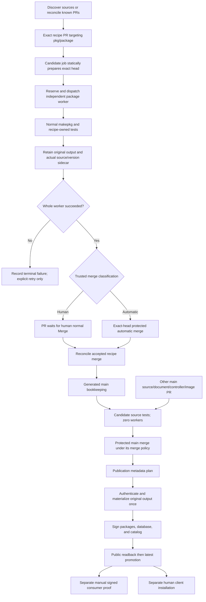
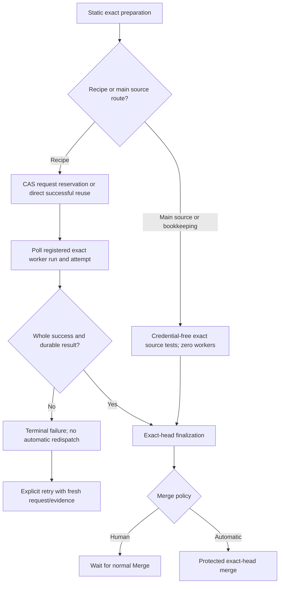
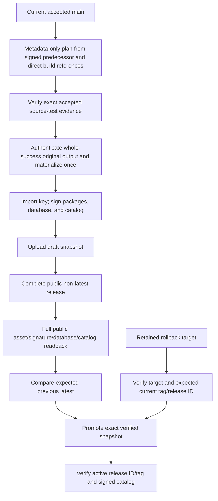

# System flow

`arch-packages` turns source changes into recipe PRs, retained builds, and signed Arch snapshots.

## Status and how to read this guide

Signed snapshot promotion and hosted installation verification have passed; live rollback and the remaining operational scenarios are still open.

Read the lifecycle first, then the workflow contracts and failure rules. [Implementation plan](implementation-plan.md) records scope, evidence, and unfinished live acceptance. [README](../README.md) contains client installation instructions.

## Workflows, jobs, actions, and identities

A workflow is a YAML entrypoint. A job runs on a runner. Steps within a job run sequentially; an action implements a `uses` step. A worker here is an independent workflow run, not a reusable workflow job.

There are exactly seven workflows. None declares `workflow_call`; none uses `jobs.<job>.uses`. The source-test helper runs from the candidate job; it is not an eighth workflow or a separate source-merge job.

| Identity | Meaning |
| --- | --- |
| Controller | Authenticated trusted-main tools used for preparation or execution |
| Base/predecessor | Exact proposal base or previous accepted recipe |
| Head | Exact PR head, not a moving branch name |
| Request | Immutable reserved package build request |
| Input digest | Actual receipt identity for recipe, sources, policy, and harness |
| Producer | Original registered worker run and attempt |
| Accepted merge | Protected merge whose parents/tree correspond to the tested or built proposal |

GitHub controller, recipe, base, and head SHAs are full 40-character values. Actual Git source commits support 40- or 64-character object IDs. Do not confuse source IDs with GitHub workflow identities.

A queued request may execute under a later authenticated trusted-main harness. Keep the original request immutable and record the actual harness and producer. Controller movement alone must not restart the same request or rewrite its history.

Candidate preparation is static. It does not invoke a recipe. A `PKGBUILD` function called `prepare()` is different: it is executable recipe code that `makepkg` may run in the worker container.

## Data and ownership

| Location | Purpose |
| --- | --- |
| `packages.json` | Enrollment policy and authenticated pending imports |
| `recipes/`, `.gitmodules` | Accepted recipe gitlinks and their mapping |
| `pkg/<package>` | Maintained recipe history and recipe PR target |
| `aur/<package>` | Imported AUR ancestry |
| `inputs/` | Accepted actual version and source records |
| `intents/` | Authenticated prospective AUR metadata for accepted packages, not publication inputs |
| `upstream/` | Accepted upstream/update tracking |
| `acceptance/` | Accepted recipe-to-original-build references |
| `controller-state` | Direct pending, immutable request/result, proposal, and acceptance records |
| Workflow artifacts | Expiring handoffs and diagnostics, not durable package authority |
| Draft build releases | Durable original unsigned archive, attestation, and bound asset metadata |
| Public snapshot releases | Signed packages, databases, catalog, original provenance, and retained legal assets |

Pending state is directly keyed by package. Immutable build requests and results are directly keyed by request identity. Lookups are read-only: they do not search historical workflow runs or discover substitute output.

An operation-level `StateSnapshot` resolves the state tip once, batch-loads exact records through GraphQL, and caches immutable values. PR heads/checks come from paginated GraphQL. Controllers compare locally and write only changes. Writers use exact leases/CAS and refresh around competing writes. Concurrency groups help serialization but do not replace request reservation.

The same operation scope reuses successful full-SHA commit/tree API responses and public SHA-pinned recipe archives. JSON consumers receive independent values, and authorized reads are separated by credential identity. Archive reuse retains streaming bounds and atomic destination replacement; owned cached files are removed when the operation ends. Mutable refs, PRs, statuses, writes, failed reads, and other download URLs are not cached.

Recipe exports always validate the complete enrolled pin roster. Reconciliation starts with pin metadata; discovery exports active packages, not pending imports; writing exports only changed receipt packages; single-package acceptance exports that package. Historical harness declarations referencing unselected recipe roots retain the full-payload fallback.

Draft build assets are not platform-immutable just because they are on GitHub. Inclusion checks their bound IDs, sizes/digests, archive/context attestation, exact request, producer, and whole-worker success. An OIDC attestation is provenance, not a pacman signature. Compiler cache is neither output nor authority.

## Lifecycle



There is no pre-build human approval. New/imported recipes and non-trivial or executable recipe changes build first, then wait for the human's ordinary **Merge**. Independently eligible literal changes can auto-merge only after durable output and the entire worker's final success.

A successful internal compile step, uploaded archive, passing candidate status, or attestation cannot override a failed worker. There is no failed-worker salvage, compilation checkpoint, historical run search, or transport-recovery route.

After recipe merge, reconciliation verifies the exact head/merge relationship and generates main bookkeeping. It records the gitlink, actual source/version data, upstream information, and original build reference. Pending imports can activate at this point. An accepted package's exact current intent can install its prospective policy and tracking at this same boundary; bookkeeping atomically removes the consumed intent. Bookkeeping selects zero workers and requires no second recipe approval or build.

All main documentation, source, controller, image, and bookkeeping candidates use one source-test route with zero package workers. A human-classified PR stays open until ordinary protected Merge, which the assistant may perform for authorized internal changes. External PKGBUILD changes require user approval. Generated exact bookkeeping can merge automatically after validation. No alternative manual source-review workflow remains in the core.

## Recipes and actual metadata

Clone recipe history with:

```fish
git clone --recurse-submodules https://github.com/vith/arch-packages.git
```

Recipe PRs target `pkg/<package>`. The Files changed tab contains the actual `PKGBUILD`, patches, install scripts, and payload. Changed package contents require a version or `pkgrel` bump. Recipe-root branches have no workflows; writers, reconciliation, or humans explicitly dispatch validation.

Pending import registration freezes source data without executing a recipe. Pending imports are not routine discovery/publication inputs. Their first conversion builds as an exact recipe PR and waits for human Merge.

Initial AUR imports use the authenticated AUR version floor, not an unpublished legacy recipe counter. Local release corrections use fractions above the AUR counter and below its next integer. Final candidate preparation revalidates the intended policy, sources, and AUR provenance before allowing this initial reset; published recipes retain their version-increase requirement.

Normal native `makepkg` performs Git checkout with its branch, history, and reachable tags. Planned source locks are detection/classification snapshots, not instructions to rewrite source references or force a different checkout. No source bundle or extra source-submodule scheme is introduced.

Fixed Git commit declarations retain their literal object identity and genuine reachable tag context without invented refs. Fragment-free Git sources enroll the actual remote HEAD branch; a changed default is rejected rather than silently selecting the old branch. Indexed source declarations and explicit single-character version translation retain native package versions, source ordering, and checksum algorithms while supporting upstream tag spelling.

Local AUR source files retain their native regular or executable mode. Admission verifies the declared checksum in either case; an executable bit does not authorize running the source during metadata authentication.

The worker records actual full Git commits from the working copies used by the build, reachable tag/version context, actual generated metadata, and resulting version in a sidecar outside package archives. Keep the original recipe SHA/tree and original `.SRCINFO` declaration. For a recipe with `pkgver()`, actual `pkgver` may differ from the declaration. Do not refresh metadata into another recipe commit and build again.

Non-version declarations still have to agree: package names, output set, architecture, epoch, `pkgrel`, sources, and dependencies are not ignored. The actual resulting version must be greater than the accepted predecessor, using native Arch version comparison.

Independent `.SRCINFO` field ordering is not a declaration change. Repeated source and checksum values retain their ordering and scope. Packaging options use makepkg's last-setting-wins precedence, so a repeated identical option does not change the effective declaration.

Native archive names include the full version, including an epoch. The worker validates that name before copying unchanged archive bytes to the repository's established epoch-free release-asset name. Receipts and `.PKGINFO` retain the full version. Optional empty `url` and `pkgdesc` fields are accepted; required package identity fields remain nonempty and unique.

Manual and human-edited heads use `declared_metadata` mode. Automatic discovery and unedited automation proposals retain their independent derivation checks. Mode selection is not permission to accept inconsistent sources or unsupported recipes.

Accepted inputs advance only after accepted recipe merge. Discovery, a queued request, a successful but unmerged build, and a failure leave main's accepted baseline unchanged.

## Exact workflow inventory

All supplied checkouts use `persist-credentials: false`. Only `build-package.yml` uses compiler cache and OIDC attestation. Only the publisher's signing step receives private signing credentials. Permission tables below use GitHub scope names; omitted scopes are not grants.

| File and workflow name | Trigger | Jobs |
| --- | --- | --- |
| `update.yml` — Source update proposals | Main push; cron `17 */6 * * *` UTC; `workflow_dispatch` | `reconcile`, `discover`, `write-proposals`, `report-package-failures` |
| `candidate-dispatch.yml` — Start candidate validation | Main-target `pull_request_target`: `opened`, `synchronize`, `reopened`, `ready_for_review` | `dispatch` |
| `candidate.yml` — Exact candidate validation | `workflow_dispatch` | `candidate` |
| `build-package.yml` — Build one package | `workflow_dispatch` | `package` |
| `verification.yml` — Trusted main regression tests | Main push only | `regression-tests` |
| `publish.yml` — Signed package snapshots | Main push; `workflow_dispatch` | `collect`, `rollback`, `publish` |
| `consumer-proof.yml` — Signed snapshot consumer proof | `workflow_dispatch` | `consumers` |

### Source update proposals: `update.yml`

Workflow default permission is `contents: read`. `ARCH_WORK` is `/home/runner/.local/state/arch-packages/work/arch-packages/<run>/<attempt>` and `TMPDIR` is its `tmp` directory. Concurrency is `source-update`, with `cancel-in-progress: false`.

| Dispatch input | Type, required/default | Meaning |
| --- | --- | --- |
| `bootstrap` | Optional boolean, `false` | Read-only initial static source freeze; no recipe execution or proposals |
| `migrate_pr` | Optional string, empty | Convert or backfill one legacy PR using trusted main |
| `reconcile_pr` | Optional string, empty | Reconcile one exact recipe or bookkeeping PR |

Explicit PR numbers must be positive decimal values. Migration and targeted reconciliation cannot be combined. Neither can be combined with bootstrap. Update bootstrap is not the prerequisite's immutable source-workflow bootstrap.

| Job | Guard/dependency | Permissions and steps |
| --- | --- | --- |
| `reconcile` | Main ref; skip only read-only bootstrap without an explicit target | contents, pull-requests, actions, statuses write. Validate mode; prepare scratch and `libarchive-tools`; checkout event SHA; run `migrate-existing --pr` for migration, otherwise `reconcile` with optional `--pr`. |
| `discover` | Needs reconcile. `always()` admits success or skip; main only; not push; no migration/targeted reconciliation | contents read. Prepare tools; checkout event SHA; run static `bootstrap` or `discover`, then `pack`; upload `source-receipts`. |
| `write-proposals` | Needs discover; excludes bootstrap and both explicit modes | contents, pull-requests, actions, statuses write. Prepare tools; checkout event SHA; download `source-receipts`; bounded validated extraction; run `write`. |
| `report-package-failures` | Always runs after all three stage jobs on main | No permissions. Fail the overall run if any completed stage reports contained package failures. |

`source-receipts` contains `source-data.tar`, retained for 2 days, with missing files an error. No job declares a timeout.

Push runs reconciliation only. Schedule/default manual runs reconciliation, discovery, then proposal writing. Bootstrap runs discovery only. Targeted reconciliation and migration skip discovery and writing.

Normal reconciliation, discovery, and proposal writing isolate package-local failures and process the remaining packages before reporting all failures. Failed discovery drops that package's partial receipts and work; failed acceptance or proposal guards remain enforced without advancing its accepted baseline. Shared invalid batch data or an advanced control base still aborts the stage. Explicit single-PR reconciliation and migration remain strict.

The updater CLI exits with status 2 for contained package failures after processing the batch. Workflow stages use `--defer-package-failures` to report errors and export their counts without stopping downstream healthy work; `report-package-failures` then fails the overall run if any package operations failed. The flag does not defer shared-batch failures or weaken validation. Packing and extraction do not replace an earlier stage's failure count.

Reconciliation tracks directly known open, merged, and closed PRs. Same queued/running/successful input is a no-op; the same failure is reported without automatic retry. If upstream moves during a build, wait for the actual result before refreshing the same automation-owned PR. Preserve human edits and one update PR per package. An unchanged source receipt with no open proposal leaves its retained branch untouched. Writes, refreshes, and dispatches require authenticated watcher ownership.

New watcher proposals use one per-package leaf, `recipe-updates/<pkgbase>/candidate`; retained legacy `recipe-updates/<pkgbase>/<watcher-id>` refs remain unchanged. The writer and authenticated ownership checker share this construction. Fresh legacy migrations use the current leaf, while authenticated immutable originals replay their original `head_branch`.

A behind-main captured source base is skipped so other work continues. The controller does not rebase a human branch. Targeted reconciliation does not redispatch unrelated PRs. Legacy migration does not transfer approval authority or salvage failed workers.

### Metadata dispatcher: `candidate-dispatch.yml`

The independent `dispatch` job runs only when the event PR is not a draft. Workflow permissions are contents read, pull-requests read, actions write, and statuses write. There are no dispatch inputs, concurrency group, or explicit timeout.

It checks out `${{ github.sha }}` with credentials disabled and invokes `tools.update.dispatch` with the PR number. This is protected event-base code, never the proposed checkout. It performs metadata routing to candidate validation, not recipe execution. Recipe-root PRs use explicit handoffs because their branches contain no workflows.

### Exact validation: `candidate.yml`

Run title is `Candidate PR <pr_number> head <expected_head>`. Dispatch inputs are:

| Input | Type, required/default | Meaning |
| --- | --- | --- |
| `pr_number` | Required string | Exact same-repository PR |
| `expected_head` | Required string | Exact PR head SHA |
| `retry` | Optional boolean, `false` | Explicit retry of failed source validation or a failed/unregistered package request |

The workflow defaults to contents read. Its only job is `candidate`, main-only, with a 210-minute timeout and contents/actions/pull-requests/statuses write. Concurrency is `candidate-<PR>`, with replacement cancellation disabled. Scratch uses the same run/attempt path as update.

Sequential steps are:

1. Prepare scratch and trusted archive tools.
2. Checkout the dispatch controller SHA without stored credentials.
3. `prepare`: statically prepare the exact PR under `EXPECTED_HEAD`; add `--retry` only when requested.
4. For `steps.prepare.outputs.kind == 'recipe'`, call `tools.package_runs collect` to reserve/dispatch or reuse the directly recorded worker result. This step does not compile or download package bytes for merge.
5. Finalize with the prepared base/head and `candidate.json`.
6. On failure, and only if prepare itself succeeded, run `fail-build` for the prepared record.

These are steps, not separate prepare/build/validate/finalize jobs. There is no environment review job or candidate attestation action.



Required contexts remain `verify`, `recipe-policy`, and `candidate-build`. `recipe-policy` means supported inputs and trusted merge classification, not human approval to execute. Changed heads cannot reuse old checks.

Source verification markers bind base and PR; the status SHA supplies head identity. Terminal source failure needs `retry=true`; an unchanged failed/running/successful source validation is not redispatched. Failures during source preparation are caught and reported only after a fresh identity check. The workflow's last failure step does not cover unsuccessful prepare, so that guarded reporting belongs in preparation code. A stale identity cannot write a failure onto a replacement head.

Main candidates use the sole source helper in this job. It checks allowed scope, executes complete exact tracked-source tests without credentials, and records evidence. Generated bookkeeping is independently reconstructed rather than treated as arbitrary package edits. Human source branches are not rebased by automation.

Finalization rechecks current identity. Human recipe policy leaves the successful PR open; automatic policy uses ordinary exact-head protection. Recipe merges hand off reconciliation. Main merges hand off publication when Actions-token merging would suppress push workflows.

### Independent worker: `build-package.yml`

Run title is `Build <package> / <request_id>`.

| Input | Type, required/default | Meaning |
| --- | --- | --- |
| `package` | Required string | Requested package |
| `pr_number` | Required string | Exact recipe PR |
| `recipe_sha` | Required string | Exact recipe commit |
| `request_id` | Required string | Reserved build request |

The sole `package` job is main-only with a 150-minute timeout. Workflow permissions are contents write, actions read, id-token write, and attestations write. Concurrency is `package-request-<request_id>`, with `cancel-in-progress: false`. It has no environment approval.

`WORK` is `/home/runner/.local/state/arch-packages/build-<run>-<attempt>`; `TMPDIR` is its `tmp` directory. `ARCH_BUILD_CACHE` is `/home/runner/.local/state/arch-packages/cache/pr/<package>/<recipe_sha>`.

The worker:

1. Checks out trusted main tools without stored credentials and installs archive transport tools.
2. `prepare` validates the immutable request and actual workflow identity, registers its exact run/attempt, and exports the exact recipe itself. No parent prepared bundle or approval proof is downloaded.
3. Restores this head's isolated cache using `cache-key` and `cache-input-prefix`.
4. If no own-head cache matched and an accepted key exists, restores the accepted producer's cache at its original saved path. `admit_cache` accepts only an exact match of expected and matched key into the current isolated cache.
5. Runs `tools/build.sh` without credentials.
6. Repairs cache ownership after an attempted build; saves progress for a noncancelled attempted build when the initial exact cache was not hit. Cache actions and ownership repair are nonfatal.
7. Packs original output plus `candidate.json` into `unsigned.tar`.
8. Binds original producer context, attests `unsigned.tar` and `attestation-context.json`, retains the attestation bundle, and persists durable output and the direct result.

The builder owns its private `HOME` and can create tool-specific directories there. Trusted Git configuration stays root-owned and read-only under root-owned `/build`, outside that writable home, so the builder cannot replace it.

The package container uses Docker's bundled init as PID 1 to reap orphaned descendants. The native Python harness is not the orphan reaper; process-group lifecycle checks retain their real killed-and-reaped assertions. This does not add container capabilities, host mounts, or build credentials.
A complete successful attempt includes all required steps through persistence. If a later step fails, the whole attempt is failed even if output exists. The manager polls the registered exact run/attempt endpoint and confirms completion/conclusion plus the directly recorded result. No run-list search is permitted. Persistence itself cannot establish final job success because it runs before job conclusion.

### Cache contract

Own-head progress is isolated from other unaccepted heads. It can include failed compilation progress. Only accepted provenance allows cross-head seeding.

`accepted_cache_key` must return the complete actual receipt-based key, including actual `input_digest` and exact original producer run/attempt, **and** the original saved path. Planned lock/version changes or a new producer identity must not be used to guess this key. Accepted restore has no broad restore prefix. Admission requires exact key equality; a miss or nonfatal cache error builds cold.

The own-head restore may use its input prefix as declared in YAML. That does not make it a trusted cross-PR cache. Cache restoration is never proof of successful output, merge eligibility, or inclusion.

### Main regression: `verification.yml`

This workflow is push-only. It has no manual inputs, source-identity job, source-validation job, bootstrap route, or merge job in the core.

Run title is `Trusted main verification <SHA>`. The sole `regression-tests` job has a 30-minute timeout. Permissions are contents read and statuses write. Concurrency is `verification-<ref>`, with replacement cancellation disabled.

It marks exact commit `verify` pending, checks out main without stored credentials, requires the pinned official Arch image syntax, and runs the full tests with native Arch `vercmp`. It exports exact `GITHUB_SHA` with `git archive`, copies the tracked snapshot into `/verify`, and uses `/verify/.work/tmp`. The pinned container drops capabilities, adding only the listed setup capabilities, with no-new-privileges. The final `always()` step reports success/failure, or error for other job outcomes.

Push regression is useful but is not a blind substitute for signing evidence. Publication must prove tests for the accepted tree, including bot merges that do not emit push events.

### Signed snapshots: `publish.yml`

Workflow default permission is contents read. Concurrency is `arch-packages-publication`, shared by publish and rollback, with replacement cancellation disabled. `TMPDIR` includes run and attempt under the persistent work root.

| Input | Type, required/default | Meaning |
| --- | --- | --- |
| `accepted_sha` | Optional string, no declared default | Publish exact accepted SHA; use event SHA if empty |
| `operation` | Choice, default `publish`; options `publish`, `rollback` | Select publication or rollback |
| `target_tag` | Optional string, no declared default | Retained rollback target |
| `expected_tag` | Optional string, no declared default | Expected current latest tag |
| `expected_release_id` | Optional string, no declared default | Expected current latest release ID |

| Job | Guard/dependency | Permissions/environment and contract |
| --- | --- | --- |
| `collect` | Main ref and operation not rollback | contents/actions read; 190-minute timeout. Resolve full accepted SHA and require current main; checkout it; install read-only tools; `publish.py plan`; output `accepted_sha`; upload metadata plan. |
| `rollback` | Main ref and operation rollback | contents write; `publish` environment. Checkout main; install public verification tools; verify retained target and expected current identity; explicitly promote; always upload rollback receipt. |
| `publish` | Needs successful collect | contents write, actions read; `publish` environment. Rebind current trusted main before checkout; install tools; download metadata plan; validate/materialize/sign/release/read back/activate; always upload publication receipt. |

`publish` has no separate job-level main guard; its prerequisite supplies the main-only gate. Rollback and publication are exclusive through their guards/dependency. Neither signing nor rollback declares an explicit timeout.

Artifacts are `publication-plan-<attempt>` (`publication-plan.json`, 7 days, missing is an error), `publication-receipt-<run>-<attempt>` (`publication-result.json`, always attempted, missing is an error), and `rollback-receipt-<run>-<attempt>` (`publication-result.json`, always attempted, missing warns). Receipts use the action's default retention because YAML declares no retention for them. There is no unsigned-package Actions relay or duplicate plan upload.

Metadata-only planning verifies a supported descriptor and the whole successful worker before consuming evidence. Bytes and attestation remain inclusion-step checks. The signing runner directly authenticates and materializes the original durable output once per inclusion operation, before private-key import/use. It confirms whole-worker success, exact producer/request/recipe, asset and attestation bindings, safe extraction, native package identity, and package bytes. Premerge native evidence has no package-byte SHA fields. Inclusion is where package integrity checking belongs.

AUR provenance identifies the authenticated upstream package, which can differ from the maintained package name. Publication validates the canonical URL against that upstream identity and preserves it in the catalog. Historical provenance without a separate package field uses the maintained name.

Signing also requires source-test evidence for the exact accepted controller tree. Tested PR evidence is reusable only after proving the protected merge and identical tested tree; otherwise test exact accepted main before signing. Current-main rebinding rejects stale targets.

Only the signing step has `ARCH_SIGNING_KEY`, `ARCH_SIGNING_PASSPHRASE`, and `ARCH_SIGNING_FINGERPRINT`. Trusted tools are installed before that step. Inside it, verification/materialization precedes key import/use; keys and tokens never enter recipes or consumer execution.

After verified package materialization, sign packages, create and sign databases, and sign the catalog. Existing signed content preserves original bytes, signatures, and producer proof. Snapshot tags are `snapshot-<accepted_sha>-<run_id>-<attempt>`.



Full public readback happens before promotion. After promotion, verify exact active release identity and signed catalog without downloading every asset again. Rollback verifies retained bytes/signatures/catalog and both expected current tag and release ID; it neither deletes history, rebuilds, nor re-signs.

An inclusion failure retries inclusion using the same successful build. Missing or corrupt output blocks inclusion. Publication never dispatches a worker, compiles, salvages failed output, or uses a cache as a replacement.

### Signed consumer proof: `consumer-proof.yml`

Manual dispatch has one required string input, `snapshot_tag`, with no declared default. The sole `consumers` job is main-only, with a 60-minute timeout and contents read. There is no concurrency group or environment approval.

It checks out `main` without stored credentials, installs public verification tools, and runs `tools.consumer` for the exact snapshot. Expectations and enrollment come from that snapshot's accepted commit, not today's package list. `smoke.sh` installs every enrolled target using required database/package signatures in a fresh Arch environment, then runs the retained package-specific consumer proofs.

Nasc's corresponding-source archive is selected by its locked checksum from the signed catalog's source assets and downloaded anonymously from the exact snapshot release. The proof checks the archive hash and installed license before exercising the TUI; native packages need not install their source archives.

`PROOF_WORK` is `/home/runner/.local/state/arch-packages/work/consumers-<run>-<attempt>`, with `TMPDIR` below it. `consumer-proof-<run>-<attempt>` uploads evidence under `always()`, retained for 14 days; missing evidence warns.

The disposable consumer root has private `/dev`, PTY and `/proc` mounts. Its `/dev/fd` points to `/proc/self/fd` so Bash process substitution works without exposing host devices. Consumer processes still run with no capabilities.

Surge's offline proof requests completion of the `completion z` prefix and checks that it resolves to `zsh`. It exercises the installed CLI rather than searching generated completion-script text for command names.

OMP is installed when enrolled but has no shared CLI/help/addon/PipeWire runtime tests. Recipe-owned checks remain in the build. ApexShot consumer proof covers version/help, native messaging, libraries, desktop assets, and extension files, not interactive live capture or recording.

Publication does not dispatch this workflow. Signed consumer proof is not installation on a client's machine.

## Administration, evidence, and clients

Six step-level entrypoints from five repositories are used. Restore/save share a repository and pin. These are pinned external actions, not local composite actions or reusable workflows. Shell, Python, `gh`, and Docker commands are `run` steps.

| Entrypoint and full pin | Role | Workflow users |
| --- | --- | --- |
| `actions/checkout@3d3c42e5aac5ba805825da76410c181273ba90b1` | Checkout | All seven workflows |
| `actions/upload-artifact@043fb46d1a93c77aae656e7c1c64a875d1fc6a0a` | Expiring handoff/evidence | update, publish, consumer-proof |
| `actions/download-artifact@3e5f45b2cfb9172054b4087a40e8e0b5a5461e7c` | Artifact handoff | update, publish |
| `actions/attest@1e69f48acb82d1966a394da916b4c1698aa569d6` | Original worker OIDC archive/context attestation; YAML labels v4.2.2 | build-package |
| `actions/cache/restore@55cc8345863c7cc4c66a329aec7e433d2d1c52a9` | Isolated own-head or exact accepted-producer restore | build-package |
| `actions/cache/save@55cc8345863c7cc4c66a329aec7e433d2d1c52a9` | Noncancelled attempted-build progress | build-package |

All five declared concurrency groups use `cancel-in-progress: false`: source update, candidate PR, package request, verification ref, and publication. This prevents automatic replacement cancellation of a running job; it does not prevent human cancellation, timeout, or replacement of pending work. It is not dispatch deduplication.

## Trust boundaries

| Boundary | Rule |
| --- | --- |
| Metadata/static host | Trusted control holds API credentials; does not execute recipes |
| Package worker | Disposable pinned Arch x86_64 container, unprivileged builder, no inherited tokens |
| Worker mounts | Only checked, job-owned nonsymlink cache; no host root/home/checkout/credentials or Docker socket |
| Source tests | Complete exact tracked snapshot in credential-free pinned Arch sandbox; no `.git` or ignored state |
| Publication | Trusted host verifies output and signs; package staging has sanitized environment and no private-key home, token, or Docker socket |
| Consumer setup | Fresh copied root with setup-only mount/capability needs; these privileges are not package-build privileges |
| Consumer execution | Capability-dropped execution with clean environment; public proof isolation remains |
| Client | Human configures pacman and installs; no automated client administration |

Pending imports can revise intended policy, source locks, and upstream provenance against a pinned AUR baseline authenticated from canonical AUR Git or its Arch GitHub mirror. Admission preserves imported origins and recipe pins, leaves accepted packages unchanged, and selects no package workers. External recipe changes still require their separate candidate build and review; metadata admission is not recipe acceptance.

Already-accepted packages register or revise candidate-only intents against the exact current recipe predecessor. Admission authenticates the selected canonical AUR branch history and frozen source identities, and permits changes only in `intents/`. Stock policy retains AUR outputs and source declarations; maintained policy supports necessary source-only or architecture corrections. Deliberate release advancement does not rewrite the authenticated upstream baseline. Accepted policy, inputs, tracking, and original build evidence remain unchanged until exact reviewed acceptance. A stale or changed intent cannot reuse an unrelated request or authorize automatic recipe merge.

Official Arch dependencies come first, then signed `vith-gh`, then signed n3t `vith-arch`. Workers use pacman's dependency and virtual-provider resolution before enabling each fallback; an already satisfied transaction does not contact unused repositories. Database or other operational errors stop setup rather than trigger a fallback. Custom databases and packages both require trusted signatures. When needed, worker dependency setup resolves the GitHub latest redirect to a fixed snapshot; consumer proof keeps the explicitly requested snapshot. Neither receives publication signing credentials.

Consumer preparation uses the workflow's read-only token only for release metadata and enrollment at the signed commit. Catalogs, signatures, and package assets are downloaded anonymously. The token is scoped to the trusted preparation step and is not passed to the consumer container.

Public keys are in [keys](../keys/). The signing fingerprint is `9C293ABB1F701DA04BA2C0D5711FC9BDDC5AF617`. Private signing files and the OpenTofu passphrase stay in local administrative state.

## Failure and retry rules

| Observation | Action |
| --- | --- |
| Same queued/running inputs | Poll registered exact producer; no redispatch |
| Same fully successful inputs | Reuse direct result and original producer |
| Same failed inputs | Report failure; no periodic retry |
| Explicit failed/unregistered retry | Reserve fresh request under identity/CAS guards; a failed attempt may compile again |
| Worker failed after compilation or upload | Whole attempt failed; do not salvage |
| Missing/ambiguous registration | Fail visibly; do not search history or dispatch repeatedly |
| Source terminal failure | Retry only explicitly with exact identity |
| Source preparation exception | Guard current base/head/PR afresh before reporting failure |
| Captured base behind main | Skip that candidate, continue other work, leave human branch alone |
| Inclusion failure | Retry original successful output, no compile |
| Missing/corrupt successful output or invalid provenance | Refuse inclusion |
| HTTP 403 | Report API failure with bounded numeric quota/retry headers when available; redact bodies, reasons, queries, tokens, and other headers. Do not assume authorization or quota recovery |

Package reservation is atomic and exact. The first worker registers its producer; a different worker cannot replace it. Manager finalization binds result to the registered attempt and final GitHub conclusion. Polling is bounded (the collection interface uses a 10,800-second default); it uses direct records and exact endpoints, not historical discovery.

Archive digests and attestation subjects authenticate transport. They do not add native package SHA fields or justify repeated premerge downloads. Downloads must handle Actions ZIP and release media types separately and strip API credentials from storage redirects.

## Operator commands

Examples use fish syntax. Replace `NUMBER`, `PACKAGE`, `SNAPSHOT_TAG`, and expected rollback values with actual identities.

Start exact validation on trusted main:

```fish
set head (env -u GH_TOKEN -u GITHUB_TOKEN gh pr view NUMBER --repo vith/arch-packages --json headRefOid --jq .headRefOid)
env -u GH_TOKEN -u GITHUB_TOKEN gh workflow run candidate.yml --repo vith/arch-packages --ref main -f pr_number=NUMBER -f expected_head=$head
```

Retry only when intended:

```fish
env -u GH_TOKEN -u GITHUB_TOKEN gh workflow run candidate.yml --repo vith/arch-packages --ref main -f pr_number=NUMBER -f expected_head=$head -f retry=true
```

Reconcile one known recipe or bookkeeping PR without unrelated redispatch:

```fish
env -u GH_TOKEN -u GITHUB_TOKEN gh workflow run update.yml --repo vith/arch-packages --ref main -f reconcile_pr=NUMBER
```

Run normal discovery/reconciliation, read-only bootstrap, or explicit legacy migration as separate modes:

```fish
env -u GH_TOKEN -u GITHUB_TOKEN gh workflow run update.yml --repo vith/arch-packages --ref main
env -u GH_TOKEN -u GITHUB_TOKEN gh workflow run update.yml --repo vith/arch-packages --ref main -f bootstrap=true
env -u GH_TOKEN -u GITHUB_TOKEN gh workflow run update.yml --repo vith/arch-packages --ref main -f migrate_pr=NUMBER
```

Run a retained signed install proof:

```fish
env -u GH_TOKEN -u GITHUB_TOKEN gh workflow run consumer-proof.yml --repo vith/arch-packages --ref main -f snapshot_tag=SNAPSHOT_TAG
```

Rollback is explicit and compare-and-swap guarded:

```fish
env -u GH_TOKEN -u GITHUB_TOKEN gh workflow run publish.yml --repo vith/arch-packages --ref main -f operation=rollback -f target_tag=SNAPSHOT_TAG -f expected_tag=CURRENT_TAG -f expected_release_id=CURRENT_RELEASE_ID
```

Local regression is not a package build:

```fish
python -m unittest discover -s tests -p 'test_*.py'
```

Inspect candidate identity and merge classification, then open the linked worker for live output. Confirm its exact attempt and full conclusion. For human policy, review actual recipe files and click ordinary Merge only after the required checks pass. Do not treat an internal build step as success.

## Administration and rollout evidence

[OpenTofu](../opentofu/) manages repository settings and signing secrets, not version-controlled workflow files. Use the canonical encrypted state and saved-plan workflow:

```fish
tools/tofu.sh init
tools/tofu.sh plan -out=github.tfplan
```

Inspect the encrypted saved plan before applying. After applying, verify a subsequent plan has no changes.

```fish
tools/tofu.sh apply github.tfplan
tools/tofu.sh plan
```

The wrapper uses the existing GitHub CLI login. Back up `~/.local/state/arch-packages/tofu-passphrase` and `~/.local/state/arch-packages/signing/` privately. `ARCH_STATE_PASSPHRASE_FILE` and `TF_VAR_signing_directory` override those paths. Do not print credentials or use copied state from another checkout.

Observed evidence:

| Check | Observed result | Limit |
| --- | --- | --- |
| Core full suite | 310 tests, 35.108 seconds, OK | Local checks on accepted main plus this documentation checkpoint, not workstation package compilation |
| Shell/diff checks | Passed | No package build |
| OpenTofu | fmt/validate passed; inspected plan applied using canonical encrypted state: 0 added, 0 changed, 3 destroyed (`recipe_review` and `code_review` environments; `source_review` ruleset) | Subsequent plan: No changes (exit 0); signing/publish environment and main protection unchanged |
| Real read-only state/PR check | One tip resolution, seven records batched, cached reread zero requests; 31 open PRs via GraphQL | User-token access, not App quota recovery |
| Hosted read-only smoke | [38081926361](https://github.com/vith/arch-packages/actions/runs/38081926361): both jobs successful; native 57 seconds, historical consumers 2 minutes 40 seconds | No new-controller deployment, state write, or publication |

The new native harness built a public Git fixture with declared version `0-1` and actual version `r104.gf5b1f73-1`. It recorded full commit `f5b1f735737944150331d06e0b05506f5c7d6957` and a reachable-tag context digest. The proof exercised normal branch/history/dynamic `pkgver`, archive identity, and a capability-dropped binary matching the full commit. Native evidence had no package SHA fields.

New consumer code verified and installed the exact original signed snapshot `snapshot-f5b1f735737944150331d06e0b05506f5c7d6957-38059323097-1`. Its seven enrolled targets were `apexshot`, `archive-mounter`, `carapace`, `cloudflare-speed-cli`, `nasctui`, `oh-my-pi-vith-git`, and `python-google-genai`. OMP was installed without shared runtime tests.

The historical read-only smoke used no workstation package build, signing key, state write, or promotion. Subsequent [publication 38173038296](https://github.com/vith/arch-packages/actions/runs/38173038296) succeeded through original-output authentication, signing, public readback, and latest promotion. [Hosted consumer 38178456012](https://github.com/vith/arch-packages/actions/runs/38178456012) verified the signed snapshot, installed every package, and exercised consumers. No workstation builds were performed.

External executable asleap [PR #33](https://github.com/vith/arch-packages/pull/33) built successfully before review through [candidate 38180726261](https://github.com/vith/arch-packages/actions/runs/38180726261) and [whole worker 38180781154](https://github.com/vith/arch-packages/actions/runs/38180781154). It remains open awaiting user approval; it has not been reviewed, merged, or published. Completed targeted update sweeps [38181088323](https://github.com/vith/arch-packages/actions/runs/38181088323) and [38181599263](https://github.com/vith/arch-packages/actions/runs/38181599263) preserved its exact request `f09c87fc1a54078efc4e5b3551eef0d1c70bb34f904b88b145d041b9ae342ba3` and worker, with zero new workers.

Internal [PR #74](https://github.com/vith/arch-packages/pull/74) merged through ordinary protection after fresh-head [candidate 38198027461](https://github.com/vith/arch-packages/actions/runs/38198027461) succeeded. Stale-head [candidate 38198225740](https://github.com/vith/arch-packages/actions/runs/38198225740) was rejected without overwriting the final head's successful checks. Full ordinary [updater 38198466270](https://github.com/vith/arch-packages/actions/runs/38198466270) then succeeded using `recipe-updates/<pkgbase>/candidate`, avoiding the retained-parent/child Git ref collision without deleting the old integration ref. Stale main PRs #59/#60 were not redispatched; genuine OMP [PR #75](https://github.com/vith/arch-packages/pull/75) and its worker proceeded.

[OMP worker 38198934711](https://github.com/vith/arch-packages/actions/runs/38198934711) restored PR #69's exact accepted producer cache and passed production `admit_cache`, but failed because `wasmtime-c-api-impl` could not spawn `cmake`. Output packing/persistence were skipped, result was null, and [candidate 38198773907](https://github.com/vith/arch-packages/actions/runs/38198773907) failed. No output from that failed producer was accepted.

User-approved maintained repair [PR #76](https://github.com/vith/arch-packages/pull/76) added only `cmake` to make dependencies and bumped `pkgrel` to 2. Its entire original [worker 38200772039](https://github.com/vith/arch-packages/actions/runs/38200772039) succeeded, producing `18.9.1.vith.r375.gf86f24026197-2` from full software commit `f86f24026197733729ff96f198bea8806ff7959f`. It also restored the exact accepted producer cache at `/home/runner/.local/state/arch-packages/cache/pr/oh-my-pi-vith-git/a8be88808739a0a4bbc024e113b88cb075805f80`, with identical expected/matched keys and successful admission. This proves a completed build after exact cache admission, not compiler hits or speedup.

PR #76 merged through ordinary protection after [candidate 38200650232](https://github.com/vith/arch-packages/actions/runs/38200650232) succeeded. Automatic bookkeeping [PR #77](https://github.com/vith/arch-packages/pull/77) accepted that original schema-3 output into main `17d7f0d1e14f42e5d83585d0e5f9d1b7a44da9ae` after [candidate 38202599185](https://github.com/vith/arch-packages/actions/runs/38202599185), with no package worker. GitHub marking ancestor PR #75 merged by containment does not turn its failed worker or the human-classified repair into a successful literal-policy automatic merge.

[Publication 38202883060](https://github.com/vith/arch-packages/actions/runs/38202883060) authenticated the original repaired output, signed the complete repository, verified public readback, and promoted immutable snapshot `snapshot-17d7f0d1e14f42e5d83585d0e5f9d1b7a44da9ae-38202883060-1` to `latest`, without rebuilding. [Hosted consumer 38203383503](https://github.com/vith/arch-packages/actions/runs/38203383503) verified that exact signed snapshot, installed all seven enrolled packages, and exercised existing consumers in 2 minutes 31 seconds. OMP was installed without shared OMP runtime probes. No workstation packages were built or changed.

Successful automatic literal merge, full source retry, rollback, post-build/inclusion retries, concurrency, and corrupt-output handling remain unproved. No fresh open failed main source candidate was available for retry proof; the existing source PRs #59/#60 had stale captured bases and success/pending checks. Hosted acceptance is not complete.

Temporary hosted concurrency, post-persistence failure, archive-fault, and inclusion-retry probes are paused at the user's request. Live rollback remains pending. No temporary probe controls or rollback were performed.

## History, licensing, and clients

Preserve public signed snapshots, original producer provenance, historical database filenames, corresponding source, license assets, and rollback. Failed legacy producers cannot enter the new live route through salvage. Directly known fully successful old output can be considered during controlled migration; unchanged signed snapshots remain readable without a historical worker scan.

Use `[vith-gh]` for snapshots with `vith-gh.db`, `[arch-packages]` for historical `arch-packages.db`, and leave separate `[vith-arch]` dependencies alone. Cross-rename rollback requires the matching client section. Keep signature checks enabled and verify the full signing fingerprint.

The retained Nasc history and GPLv2 corresponding source are linked in [README](../README.md#licensing-and-retained-source). Public integrity, signed consumer proof, and a human's client installation are separate outcomes.
