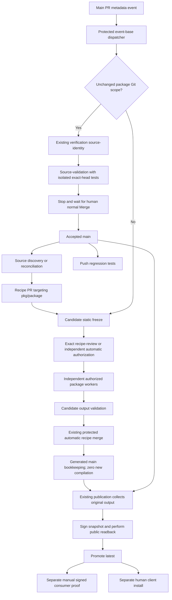

# System flow

This guide describes the **interim system with the small source-routing prerequisite**, not the later core cutover. The prerequisite routes unchanged-package main PRs into existing source-only verification and stops that verification before merge. Recipe approval, worker execution, checkpoints, caches, recovery, and publication otherwise remain unchanged.

`arch-packages` turns source updates into reviewed recipes, authenticated builds, and signed Arch snapshots. This repository owns its controller, workflows, tests, and package policy. The OMP fork supplies input and n3t supplies signed dependencies. This pipeline administers neither and never installs packages on client machines.

## Workflows, jobs, and identities

A workflow is a YAML entrypoint containing jobs. Jobs contain sequential steps; actions implement `uses` steps. Independent workers are `build-package.yml` runs, not reusable workflows. The interim seven workflows declare no `workflow_call` and use no `jobs.<job>.uses`.

| Identity | Interim contract |
| --- | --- |
| C | Immutable trusted controller/harness revision |
| B | Exact proposal base or predecessor |
| H | Full exact reviewed PR head |
| Input digest | Authenticated recipe, source lock, policy, and compilation identity |
| Original producer | Authenticated successful compilation run and attempt, preserved through old recovery and publication |

Keep recipe head, trusted controller, and accepted merge identities distinct. Old-head approval does not authorize a changed head. Candidate static preparation is not the executable recipe `prepare()` function.

| Location | Contents |
| --- | --- |
| `packages.json` | Enrollment policy and pending-import registry; registration grants no execution authority |
| `recipes/`, `.gitmodules` | Accepted recipe gitlinks and mapping |
| `pkg/<name>`, `aur/<name>` | Maintained recipe and imported AUR histories |
| `inputs/`, `upstream/`, `acceptance/` | Frozen locks, accepted tracking, and original-build mapping |
| `controller-state` | Retained proposal/candidate/provenance/build/approval/acceptance records |
| Workflow artifacts | Expiring transport and diagnostics |
| Never-public draft build releases | Durable unsigned bytes and proof |
| Public snapshot releases | Signed packages, databases, catalog, and retained provenance/legal assets |

Identity envelopes remain immutable. Concurrent state writes preserve other receipts through exact leases and bounded retries. Workflow artifacts are not durable authority. Attestations are OIDC provenance, not pacman signatures. Compiler cache is not successful package output.

## Interim lifecycle



The prerequisite changes only the metadata-to-source route and its endpoint. Source-only validation writes evidence and statuses, then waits for human normal Merge. It does not merge or dispatch publication.

Recipe execution still follows old exact pre-build approval/automatic authorization. Existing recipe merges remain automatic after authorized validation, with no separate human merge approval. Generated bookkeeping needs no second recipe approval or build.

Pending imports stay outside routine discovery/publication until activation. Their first conversion uses the existing exact recipe-approval contract. Registration itself does not execute recipes.

## Exact prerequisite dispatcher contract

[`candidate-dispatch.yml`](../.github/workflows/candidate-dispatch.yml), named **Start candidate validation**, handles main-target `pull_request_target` events: `opened`, `synchronize`, `reopened`, and `ready_for_review`. It has no manual inputs, concurrency group, or explicit timeout.

Its only job is `dispatch`, guarded by `github.event.pull_request.draft == false`. Workflow permissions are contents read, actions write, and pull-requests read. The job has two steps:

1. `actions/checkout@3d3c42e5aac5ba805825da76410c181273ba90b1`, checking out `${{ github.sha }}` with `persist-credentials: false`.
2. A Python `run` step using `gh` metadata and protected-base `tools.source_review.unchanged_git_scope`.

The checkout is the protected event base. No proposed PR code executes in the dispatcher. The fresh PR read requires an open, non-draft, same-repository, main-target PR. The current main ref is read independently. If the captured PR base differs from current main, the job prints a skip and dispatches nothing. It does not rebase the human branch or block unrelated work.

The scope helper compares recursive Git trees at exact base/head. Package scope includes `packages.json`, `.gitmodules`, `recipes`, `inputs`, `upstream`, and `acceptance`, including the corresponding directory entries. Trees must be complete, not truncated. The head's verification workflow must be a regular `100644` blob, and package enrollment must be present.

If scope is unchanged, the dispatcher runs `verification.yml` on main with `pr_number`, `expected_head`, and `expected_base`. A scope `ValueError` selects existing `candidate.yml` with PR/head instead; it is not permission to execute candidate files in this metadata job. Unexpected failures are not hidden as successful validation.

Recipe-root branches have no workflows. Their writers, reconciliation, or humans retain explicit candidate dispatch handoffs. This event route applies only to main-target PRs.

## Existing source verification, ending at human Merge

[`verification.yml`](../.github/workflows/verification.yml) is named **Trusted recipe and publication verification**. It runs on main push and `workflow_dispatch`.

| Dispatch input | Type, required/default | Effect |
| --- | --- | --- |
| `pr_number` | Required string | Exact main PR for source-only verification before human Merge |
| `expected_head` | Required string | Exact head H |
| `expected_base` | Required string | Exact base B, equal to current main |
| `bootstrap` | Optional boolean, `false` | Select initial controller from exact immutable `source-review-<H>` tag |

Titles are `Trusted main verification <SHA>` for push and `Source review PR <N> head <H> base <B>` for dispatch.

Default permissions are contents read and statuses write. Concurrency is `verification-<event_name>-<PR or ref>`, with `cancel-in-progress: false`. `ARCH_WORK` is `/home/runner/.local/state/arch-packages/work/source-review/<run>/<attempt>` and `TMPDIR` is its `tmp` directory.

| Job | Guard/dependency | Permissions and contract |
| --- | --- | --- |
| `source-identity` | Manual dispatch only | contents, pull-requests, actions read. Bind exact workflow/run/ref/title, PR/base/head, and unchanged package Git scope read-only before any checkout. |
| `source-validation` | Needs source-identity | contents, pull-requests, actions read; statuses write. Prepare scratch; checkout protected base, or bootstrap head; run source validator; upload evidence. |
| `regression-tests` | Main push only | Inherits contents read/statuses write; 30-minute timeout. Pending status, exact main export and pinned Arch tests with native vercmp, always report result. |

There are exactly these three jobs. Source jobs declare no timeout. There is no merge job or finalizing source helper. A successful `source-validation` ends the source route.

### Identity before checkout

The inline `source-identity` step checks positive decimal PR number and full 40-character lowercase base/head SHAs. It requires an open same-repository main PR with exact base/head and base equal to current main.

Normal workflow identity is the exact base on `refs/heads/main`. Bootstrap identity is exact head on `refs/tags/source-review-<H>`. The actual run/attempt must match workflow SHA, branch, event `workflow_dispatch`, path `.github/workflows/verification.yml`, and exact display title. Bootstrap also requires a direct commit tag pointing to H. This is checked through read-only Git objects before checkout.

The job compares complete recursive package-scope trees and verifies the regular verification workflow blob. It rejects changed package scope, missing enrollment, missing workflow, or incomplete trees. Same-repository identity is mandatory; this is not an external-fork execution route.

### Validation and evidence

The `source-validation` checkout is `${{ inputs.bootstrap && inputs.expected_head || inputs.expected_base }}`. Stored credentials are disabled. The trusted helper rechecks actual authority and unchanged Git scope, exports exact base/head data, and compares policies, pins, recipe bodies, input/upstream/acceptance data, `.gitmodules`, and enrollment.

The baseline's image must be the pinned official Arch digest. Tests run on the complete exact tracked head snapshot in a credential-free sandbox. Authority is checked again immediately before tests and after tests. Temporary verification trees are removed in `finally`.

On success, the helper writes `source-review-evidence.json` with repository, base/head, bound run/attempt authority, `packages: []`, and unchanged-package proof. It reports:

- `verify`: exact source tests passed.
- `candidate-build`: unchanged package inputs verified; zero package workers.
- `recipe-policy`: exact source-only scope verified.

The upload step uses `actions/upload-artifact@043fb46d1a93c77aae656e7c1c64a875d1fc6a0a`. Artifact `source-review-evidence-<attempt>` contains that evidence file, retained for 90 days; missing evidence is an error. It is a successful-path upload, not an `always()` failure receipt.

The CLI validates only:

```fish
python3 -m tools.source_review --pr NUMBER --base BASE_SHA --head HEAD_SHA --directory EVIDENCE_DIRECTORY
```

Optional `--bootstrap` selects the immutable initial controller. No CLI step finalizes or merges. Failures stop validation; do not fabricate success or infer an automatic retry policy from the later core design.

After successful hosted validation, the human reviews the source PR and uses ordinary protected Merge. Any accepted-main publication is a later workflow, not a child of source validation. Keep explicit operator handling where Actions-token merges elsewhere suppress push events.

### Push regression

`regression-tests` marks exact commit `verify` pending, checks out without stored credentials, reads the pinned image, exports `GITHUB_SHA` with `git archive`, and copies the tracked snapshot into `/verify`. Tests use `/verify/.work/tmp`, not `/tmp`, and native Arch `vercmp`.

The container drops capabilities and adds only setup capabilities CHOWN, DAC_OVERRIDE, FOWNER, SETUID, and SETGID, with no-new-privileges. The final `always()` step reports success/failure or error for other outcomes and links the run. Official verification-tool installation is not recipe execution.

## Old source-update workflow retained

[`update.yml`](../.github/workflows/update.yml), **Source update proposals**, retains main push, cron `17 */6 * * *` UTC, and manual dispatch. Its jobs remain `reconcile`, `discover`, and `write-proposals`.

| Input | Type/default | Interim effect |
| --- | --- | --- |
| `bootstrap` | Optional boolean, false | Read-only static initial source freeze; no recipes or proposals |
| `migrate_pr` | Optional string, empty | Convert/backfill one legacy recipe candidate using trusted main |
| `reconcile_pr` | Optional string, empty | Reconcile one known recipe/bookkeeping PR |

Modes are mutually exclusive and explicit PR numbers must be positive decimals. Update bootstrap is separate from verification's immutable-controller bootstrap.

Push runs reconciliation. Schedule/default manual runs reconciliation → discovery → proposal writing. Read-only bootstrap skips reconciliation/writing. Migration/targeted recovery skip discovery/writing and targeted recovery does not redispatch unrelated PRs.

Reconcile/writer use contents, pull-requests, actions, and statuses write; discovery uses contents read. `source-receipts` carries `source-data.tar` for 2 days. Extraction is bounded and validated before writes. The `source-update` concurrency group disables replacement cancellation.

Proposals preserve ancestry in owned update branches targeting `pkg/<name>`. Writers/reconciliation explicitly dispatch recipe candidates. Unchanged source receipts without open proposals are no-ops that leave retained branches untouched; writes/refreshes need authenticated watcher ownership. Legacy approvals never transfer to a converted candidate.

This prerequisite does not introduce new batching, CAS build requests, exact-producer-only polling, or unchanged-failure retry semantics. Those are not interim deployment claims.

## Old candidate approval and worker flow retained

[`candidate.yml`](../.github/workflows/candidate.yml), **Exact candidate validation**, still uses manual/API dispatch with required string `pr_number` and `expected_head`, exact-head run title, trusted-main tools, and concurrency `candidate-<PR>` without replacement cancellation.

The existing job layout remains:

| Job | Existing contract |
| --- | --- |
| `prepare` | Static identity/input freeze; independently attest original candidate when fresh provenance is needed |
| `manual-review` | Exact `recipe-review` environment route for new/non-trivial PKGBUILD code |
| `automatic-authorization` | Independently reconstructed automatic route for eligible unchanged/literal code |
| `build` | Needs preparation and selected authorization or authorized reuse; `always()` admits the successful active route despite the inactive route's skip; tests/dispatch/collection |
| `validate` | Authenticate output after successful build |
| `report-failure` | Report candidate-build failure for unsuccessful post-prepare build/validation |
| `finalize` | Recheck required contexts and exact identity; existing protected automatic merge and explicit follow-up |

These are old candidate jobs, distinct from the source-only verification jobs above. Source-only main events now avoid this overlapping route when unchanged scope is proven. Other candidate behavior is not altered.

The original exact static candidate and prebuild OIDC provenance remain independently retained. New/non-trivial recipe code needs genuine exact candidate/run/attempt human environment approval **before execution**. Eligible unchanged/enrolled literal transitions are independently authorized; invalid source/metadata fails rather than adding an irrelevant prompt. Exact authorized successful reuse skips another approval/compilation.

Post-build validation follows either authorization route. Skipping an inactive review/automatic job does not skip validation. Required contexts remain `verify`, `candidate-build`, and `recipe-policy`. Existing authorized recipe merges use normal exact-head protection without a separate human merge approval.

[`build-package.yml`](../.github/workflows/build-package.yml), **Build one package**, retains its independent main-only `package` job, 150-minute timeout, and old `approved-package-<input_digest>` concurrency. Its old dispatch fields remain:

| Input | Type/default | Purpose |
| --- | --- | --- |
| `package` | Required string | Authorized package |
| `publication_run` | Required string | Original authorization coordinator run |
| `publication_attempt` | Required string | Original coordinator attempt |
| `input_digest` | Required string | Exact authorized compilation identity |
| `recovery_mode` | Boolean, false | Transport-only recovery |
| `original_run` | String, empty | Successful original producer |
| `original_attempt` | String, empty | Original attempt |
| `original_artifact` | String, empty | Bound original artifact descriptor for recovery |
| `original_candidate_key` | String, empty | Historical candidate receipt key |
| `archive_format` | Choice, `native-v2` | Also supports retained `legacy-native-v1` |

A worker authenticates parent workflow/head/run/attempt and durable exact authorization before execution or trusted cache use. Normal preparation downloads prepared input; independent one-root recipe candidates export their owned payload while authenticating the complete roster/pins. Historical harnesses may require full exports.

The old root-owned `compilation.json` checkpoint starts before recipe execution and distinguishes successful, failed, and not-started compilation. Overall run color is not the old compilation-success authority. Successful original bytes may require recovery after metadata/runtime/copy/upload/attestation/storage failure; they must not be recompiled. Actual authenticated failed compilation may retry. Unknown or unrecoverable successful state refuses rather than inventing output.

Old recovery authenticates original checkpoint, artifact ID/digest/size, source/controller declarations, and producer. It runs no recipe and uses no compiler cache. Durable `unsigned.tar`, context, and OIDC bundle are verified before reuse. Literal historical harness/controller manifests are parsed without executing historical Python; missing declared files or unsafe paths fail.

Approved normal workers restore/save compatible package/image/harness dependency/compiler caches, including noncancelled failed compilation progress. Cache failures are nonfatal and ownership is repaired. Unapproved code cannot seed trusted caches. Cache is not successful output.

Old native validation retains `.SRCINFO` consistency, output identity/version/architecture/hashes/source-lock checks and OMP version/help/addon/PipeWire runtime evidence. These checks are not removed by this prerequisite. Recipe-owned tests also remain.

## Old bookkeeping, publication, and consumers retained

Accepted recipe merge bookkeeping verifies exact reviewed head and accepted merge parents/tree, then records gitlink, lock, upstream, and original build provenance. It can activate pending imports. It requires no second recipe approval or package build. Existing main candidate behavior outside the narrowed source-only event route remains unchanged.

[`publish.yml`](../.github/workflows/publish.yml), **Signed package snapshots**, retains main push and manual dispatch:

| Input | Type/default | Effect |
| --- | --- | --- |
| `accepted_sha` | Optional string, event SHA when empty | Exact accepted main |
| `operation` | Choice, publish | Publish or rollback |
| `target_tag` | Optional string | Retained rollback target |
| `expected_tag` | Optional string | Expected current latest tag |
| `expected_release_id` | Optional string | Expected current latest release ID |

Jobs remain `collect` → `publish`, or exclusive `rollback`. Collection uses contents/actions read and a 190-minute timeout. Signing uses contents write/actions read and `publish` environment. Rollback uses the `publish` environment without private signing-key variables. The shared `arch-packages-publication` concurrency group disables replacement cancellation.

The old collector verifies existing signed content or durable unsigned output and retains its existing unsigned Actions relay and publication plans. Publication rebinds accepted main, authenticates original provenance, signs packages/databases/catalog, completes a public non-latest release, performs full public readback, compares previous latest, promotes, and verifies active signed catalog.

Only signing receives `ARCH_SIGNING_KEY`, `ARCH_SIGNING_PASSPHRASE`, and `ARCH_SIGNING_FINGERPRINT`. Trusted tools install before secrets. Publication never dispatches a worker or compiles, including transport recovery. Missing original bytes fail rather than rebuild.

Snapshot tags retain `snapshot-<accepted_sha>-<run>-<attempt>`. Publication result evidence is always attempted; missing publication evidence is an error, missing rollback evidence warns. Rollback independently verifies retained signed output and both expected current tag/release ID, then promotes without deletion, compilation, or re-signing. Preserve older signatures, producer proof, database filenames, source, and licensing assets.

[`consumer-proof.yml`](../.github/workflows/consumer-proof.yml), **Signed snapshot consumer proof**, remains manual with required string `snapshot_tag`. Its independent `consumers` job has a 60-minute timeout and contents read. The old dispatch-ref behavior is unchanged by this prerequisite; do not assume the later core main-only guard has been installed.

It verifies the selected public signed snapshot, derives enrollment from its accepted commit, installs every enrolled output in a fresh Arch environment with required signatures, and runs the existing consumer proofs. `consumer-proof-<run>-<attempt>` evidence is retained for 14 days, attempted on failure too; missing evidence warns. Publication does not dispatch it.

Existing OMP consumer checks remain in this interim system. ApexShot proofs cover version/help, native messaging, shared libraries, desktop assets, and extension files. They do not prove interactive live GNOME/Wayland capture or recording. Extension enablement and client use remain manual.

## Actions and trust boundaries

The interim workflows use six pinned step-level entrypoints from five action repositories: `actions/checkout`, `actions/upload-artifact`, `actions/download-artifact`, `actions/attest`, `actions/cache/restore`, and `actions/cache/save`. They are external actions, not reusable workflows. The prerequisite dispatcher uses checkout; the prerequisite verification uses checkout and upload-artifact. Shell, Python, `gh`, and Docker remain `run` steps.

All checkouts disable persisted credentials. Only approved workers use compiler cache. API credentials/OIDC remain in trusted host tools outside recipe containers. Only publication signing receives the private key.

Workers run unprivileged in disposable pinned Arch x86_64 containers. Only authenticated nonsymlink job-owned package cache can bind; no host root/home/checkout/credential directories or Docker socket. Inputs and trusted harness are copied. Old Git source freezing uses `MAKEPKG_GIT_CONFIG` and matching system configuration with global config disabled, retaining normal configured update discovery rather than permanently pinning updates.

Dependency order is official Arch, signed `vith-gh`, then signed n3t `vith-arch`. Custom packages and databases require signatures. Worker dependency setup freezes latest-release redirects; consumers keep their selected snapshot. Neither receives signing credentials.

Source tests receive complete exact tracked files without credentials or `.git`. Publication staging has sanitized execution and no private-key home/token/socket. Consumer setup has separate mount/capability needs; actual consumer execution drops capabilities and clears environment. These are not workstation installations.

`bsdtar` is required for persistence, recovery, and bookkeeping proof. Provision `libarchive-tools` before approval/recovery archive handling. Actions ZIP transport and release downloads use different media types; storage redirects never receive API tokens.

## Interim failure and recovery caveat

The old route preserves authenticated successful compilation even when a later step fails, and recovers exact original bytes. Actual authenticated failed compilation can retry with compatible trusted cache. Missing successful bytes, uncertain outcomes, invalid provenance/signatures, and stale identity fail closed.

Existing historical lookup can still scan retained candidate keys and historical workers/jobs/artifacts before static approval merely to establish whether completed output exists. That avoidable API work is not fixed by this prerequisite and grants no authority. Recovered output still requires old authorization and provenance verification.

Coordinator failure or movement does not cancel independent children. Inspect child evidence and old checkpoints, not only run color. Collection retains its existing bounded polling. HTTP 403 is API failure, not assumed authorization or quota recovery. Do not make claims about reset times or migration progress without evidence.

Source validation errors stop the source flow. The prerequisite does not add the later core's source-marker/retry lifecycle. A dispatcher behind-base skip is a successful no-dispatch outcome; it does not update the branch or manufacture passing source checks.

## Immutable bootstrap and manual operation

For initial source-workflow installation, freeze accepted main as C and final source-only head as H. Use an owned staging base pinned to C if needed, mark ready while there, then retarget main without changing H. The dispatcher has no edited-event trigger; retargeting is not a substitute for explicit validation. Preserve the exact-PR guard and ordinary protected merge.

Create the exact direct-commit `source-review-<H>` tag under the managed `source-review-immutable` ruleset. It permits creation but forbids update/deletion, without bypass actors. Dispatch verification from that tag with `bootstrap=true`. Actual Git-object and workflow identity are checked before checkout. Successful validation still waits for human normal Merge. Keep this bootstrap contract until the later atomic core installation retires it.

Normal source validation, using fish:

```fish
set head (env -u GH_TOKEN -u GITHUB_TOKEN gh pr view NUMBER --repo vith/arch-packages --json headRefOid --jq .headRefOid)
set base (gh api repos/vith/arch-packages/git/ref/heads/main --jq .object.sha)
env -u GH_TOKEN -u GITHUB_TOKEN gh workflow run verification.yml --repo vith/arch-packages --ref main -f pr_number=NUMBER -f expected_head=$head -f expected_base=$base
```

Initial immutable-tag validation, only after verifying H and C:

```fish
set tag source-review-$head
env -u GH_TOKEN -u GITHUB_TOKEN gh workflow run verification.yml --repo vith/arch-packages --ref $tag -f pr_number=NUMBER -f expected_head=$head -f expected_base=$base -f bootstrap=true
```

Package-changing/native recipe validation remains:

```fish
env -u GH_TOKEN -u GITHUB_TOKEN gh workflow run candidate.yml --repo vith/arch-packages --ref main -f pr_number=NUMBER -f expected_head=$head
```

Targeted reconciliation, legacy migration, and read-only update bootstrap are separate modes:

```fish
env -u GH_TOKEN -u GITHUB_TOKEN gh workflow run update.yml --repo vith/arch-packages --ref main -f reconcile_pr=NUMBER
env -u GH_TOKEN -u GITHUB_TOKEN gh workflow run update.yml --repo vith/arch-packages --ref main -f migrate_pr=NUMBER
env -u GH_TOKEN -u GITHUB_TOKEN gh workflow run update.yml --repo vith/arch-packages --ref main -f bootstrap=true
```

Manual signed proof and explicit rollback:

```fish
env -u GH_TOKEN -u GITHUB_TOKEN gh workflow run consumer-proof.yml --repo vith/arch-packages -f snapshot_tag=SNAPSHOT_TAG
env -u GH_TOKEN -u GITHUB_TOKEN gh workflow run publish.yml --repo vith/arch-packages --ref main -f operation=rollback -f target_tag=SNAPSHOT_TAG -f expected_tag=CURRENT_TAG -f expected_release_id=CURRENT_RELEASE_ID
```

No workstation package compilation:

```fish
python -m unittest discover -s tests -p 'test_*.py'
```

## Administration, evidence, and clients

Repository settings and signing secrets are managed through [OpenTofu](../opentofu/) using canonical encrypted state:

```fish
tools/tofu.sh init
tools/tofu.sh plan -out=github.tfplan
```

Inspect the saved plan before any authorized apply and verify a later no-change plan. Do not remove old review gates during this prerequisite. The wrapper uses the GitHub CLI login. State/plans stay encrypted and ignored; privately back up `~/.local/state/arch-packages/tofu-passphrase` and `~/.local/state/arch-packages/signing/`. The override variables remain `ARCH_STATE_PASSPHRASE_FILE` and `TF_VAR_signing_directory`.

Observed prerequisite evidence is 284 tests in 35.155 seconds, OK with one skip, plus passing shell syntax/diff checks. This is not protected hosted installation acceptance. OpenTofu fmt/validate passed and the encrypted saved removal plan was inspected: 0 add, 0 change, 3 destroy for the `recipe_review` and `code_review` environments and the `source_review` ruleset. It has not been applied and must wait for coherent protected core code, then a no-change plan.

The selected delivery remains this prerequisite followed by one atomic core PR. No claim here installs its worker/state/cache/signing changes. User-token API access does not prove App quota recovery, and read-only smoke does not prove controller deployment, signing, promotion, or rollback.

See [README installation](../README.md#install). Verify full fingerprint `9C293ABB1F701DA04BA2C0D5711FC9BDDC5AF617` and keep signature checks enabled. Public keys are in [keys](../keys/). Use `[vith-gh]` for `vith-gh.db`, `[arch-packages]` for historical `arch-packages.db`, and leave separate `[vith-arch]` dependencies alone. Cross-rename rollback requires the matching client section.

Preserve original signed releases and Nasc corresponding-source/license history. Publication integrity, signed consumer installation, and a human's client installation are distinct outcomes.
